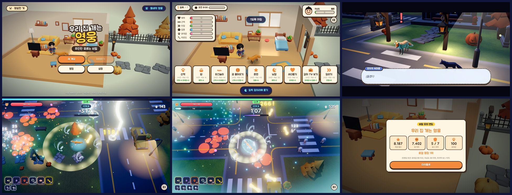

# 우리 집 개는 영웅

낮에는 평범한 개, 밤에는 동네의 영웅. 주인만 모르는 비밀을 지키며 7밤을 버티는
**육성 시뮬레이션 + 서바이버 액션** 웹 게임입니다. (three.js · TypeScript · React)

- **낮(힐링)**: 산책, 밥, 터그놀이, 훈련, 낮잠 등 9가지 행동으로 스탯을 키웁니다. 행동마다 시간과 피로가 듭니다.
- **밤(액션)**: 주인이 잠들면 몰래 나가 몬스터 웨이브를 막습니다. 공격은 자동, 조작은 이동뿐. 레벨업마다 3장 중 1장을 고릅니다.
- **의심도**: 다치거나, 늦게 들어오거나, 마당에서 싸우면 다음 날 주인이 수상해합니다. 가득 차면 시치미를 떼야 합니다.
- **엔딩 3종**: 비밀 유지 / 들킨 엔딩 / 진엔딩(유대감 90 이상 + 의심도 30 이하 + 마지막 보스 처치)

**▶ 바로 플레이: https://sunny8197783.github.io/MyPetHero/**



플레이 영상: `docs/screens/gameplay-night6.mp4`

## 실행

### 바로 실행 (설치 없음)
- 웹: https://sunny8197783.github.io/MyPetHero/ (이 저장소의 `gh-pages` 브랜치를 GitHub Pages 로 서비스)
- 오프라인: `npm run build:single` 로 만든 `dist/hero-dog.html` 파일 하나를 브라우저로 엽니다. 모델·사운드·폰트가 모두 들어 있어 더블클릭으로 실행됩니다.

### 개발 서버
```bash
npm install
npm run dev        # http://127.0.0.1:5173
```

### 빌드
```bash
npm run build          # dist/ (index.html + assets/)
npm run build:single   # dist/hero-dog.html 까지 생성
npm run build:embed    # dist-embed/ 까지 생성 (.glb/.pack 을 올릴 수 없는 호스트용: base64 JSON 으로 감쌈)
npm run typecheck
```

`dist/` 는 정적 파일이라 아무 웹 서버에나 올리면 됩니다. `file://` 로 직접 열 때는 `dist/hero-dog.html` 을 쓰세요
(`dist/index.html` 은 브라우저가 로컬 파일 요청을 막아서 서버가 필요합니다).

### 배포 (GitHub Pages)
`main` 에는 소스만 있고, 빌드 결과물은 `gh-pages` 브랜치에 있습니다. 게임을 고친 뒤에는 다시 빌드해서 올립니다.
```bash
npm run build
git worktree add ../pages gh-pages        # 처음 한 번만
cp -r dist/. ../pages/
git -C ../pages add -A && git -C ../pages commit -m "Deploy" && git -C ../pages push
```

### 테스트 (먼저 `npm run build`)
```bash
npm run test:e2e        # 타이틀 → 낮 → 밤 → 결과 → 다음 날 → 세이브
npm run test:campaign   # 7일 완주 → 엔딩 → 랭킹
npm run test:cutscenes  # 컷씬 21종 재생
npm run test:balance    # 봇이 1~7번째 밤을 플레이한 결과표
npm run test:perf       # 적 100~450마리에서 틱 시간·드로우콜·삼각형
HERO_GL=llvmpipe npm run test:nan   # 셰이더가 NaN 픽셀(블룸을 타고 화면을 검게 만듦)을 내는지 다른 GL 백엔드로 검사
node tests/capture.mjs 6 medium 118 7   # 밤 전투를 mp4·GIF 로 캡처 (ffmpeg 필요)
```

> 이 프로젝트는 npm 을 쓸 수 없는 환경에서 만들어졌습니다. 그래서 빌드 스크립트(`scripts/build.mjs`)는
> `node_modules` 가 있으면 그것을, 없으면 `../vendor/lib` 의 GitHub 클론을 씁니다.
> 일반 PC 에서는 `npm install` 만 하면 됩니다(버전은 `package.json` 에 고정).

## 조작

| 입력 | 동작 |
|---|---|
| WASD · 방향키 · 게임패드 왼쪽 스틱 · 화면 터치(가상 조이스틱) | 이동 (밤) |
| 마우스 · 터치 | 낮 행동 카드, 선택지, 대사 넘기기 |
| 1 · 2 · 3 / 좌우 + Enter · 게임패드 A | 레벨업 카드 선택 |
| Space · Enter | 컷씬 대사 넘기기 |
| Esc · 게임패드 Start | 일시정지 |
| F3 | 성능 표시 (fps, 드로우콜, 삼각형 수) |

## 폴더 구조

```
src/
  core/    엔진 루프, 진행 관리(director), 에셋 로더, 입력, 세이브, 상태(zustand)
  day/     낮 무대(집·마당)와 행동 연출, 스탯·이벤트 규칙
  night/   밤 전투: 적(SoA + 공간 해시 + VAT 인스턴싱), 무기, 보스, 보석, 맵
  story/   컷씬 실행기, 컷씬 스크립트(데이터), 무대
  vfx/     파티클, 이펙트 풀, 데미지 숫자, 카메라 리그, 후처리, 하늘
  audio/   효과음(Howler + 합성), 절차적 BGM 시퀀서
  ui/      React HUD·메뉴·대화창, CSS
  data/    밸런스 JSON (스탯, 행동, 이벤트, 적, 무기, 패시브, 웨이브, 타격감, 품질)
public/assets/   모델·사운드 (출처별 폴더)
scripts/         빌드, 에셋 파이프라인, 폰트 서브셋, 스크린샷 도구
tests/           E2E, 컷씬 스모크, 밸런스 시뮬레이션, 장면 스크린샷
docs/            DESIGN, SKILLS, QA, PERF
```

## 수치를 고치려면

코드에 박아 둔 밸런스 수치는 없습니다. 전부 `src/data/*.json` 에 있습니다.

| 파일 | 내용 |
|---|---|
| `balance.json` | 캠페인 길이, 스탯이 밤에 주는 효과, 경험치 곡선, 의심도, 점수, 엔딩 조건 |
| `actions.json` · `events.json` | 낮 행동과 일상 이벤트(대사 포함) |
| `enemies.json` | 적 7종, 엘리트, 보스 7종과 보스 패턴 수치 |
| `weapons.json` · `passives.json` | 무기 8종(레벨 1~5)과 진화 8종, 패시브 8종 |
| `waves.json` | 밤마다의 길이, 스폰 속도, 적 구성, 습격, 보스 등장 시각 |
| `feel.json` | **타격감**: 히트스톱, 화면 흔들림, 넉백, 플래시, 데미지 숫자, 카메라, 사운드, 진동 |
| `quality.json` | 그래픽 품질 3단계(해상도, 블룸, 그림자, 파티클 양 등) |

## 개발용 바로가기

| 주소 | 설명 |
|---|---|
| `?night=4&stats=40&bot=1` | 4번째 밤을 스탯 40으로 바로 시작, 봇이 플레이 |
| `?day=3` | 3일째 낮으로 바로 이동 |
| `?q=low` / `medium` / `high` | 그래픽 품질 지정 |
| `?preview=kaykit-city` (`kaykit-furniture`, `kaykit-halloween`, `chars`) | 에셋 미리보기 |

콘솔에서 `__game.director.night.debug` 로 무기 지급(`give`), 적 소환(`spawn`), 시간 이동(`skipTo`) 등을 쓸 수 있습니다.

## 기획서와 달라진 점

npm 설치가 막힌 환경이라 GitHub 에서 받을 수 있는 것으로 구성했습니다. 자세한 표는 `docs/SKILLS.md` 끝에 있습니다.

- Vite → esbuild, R3F·drei → 순수 three.js, three.quarks → 자체 인스턴싱 파티클, Theatre.js → GSAP 타임라인
- 개 모델은 Quaternius 대신 Khronos Fox(리깅·애니메이션 CC-BY 4.0), BGM 은 합성
- Draco/Meshopt/KTX2 압축 없음 (대신 쓰는 애니메이션만 남겨 GLB 를 줄임)

에셋과 라이브러리의 출처·라이선스는 [CREDITS.md](CREDITS.md) 에 있습니다.
